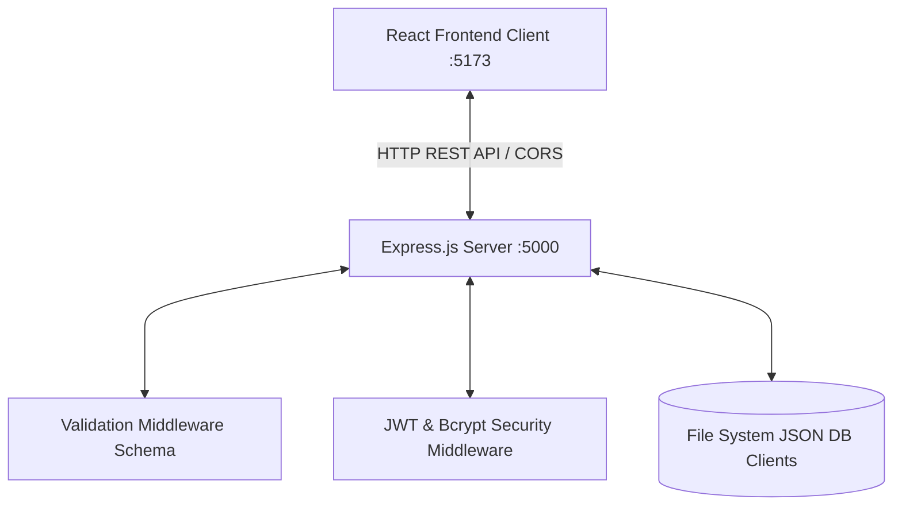

# BurnoutPredict AI: Workspace & Full-Stack Architecture

Welcome to the full-stack workplace well-being intelligence application. This workspace now contains a fully functional Node.js/Express backend integrated with an interactive React frontend dashboard, featuring robust data models, authentication pipelines, and strict schema validation layers.

---

## 🏗️ Architecture Overview

The system is structured as a decoupled client-server application:



### 1. 📂 Folder Hierarchy
- **`backend/`**: Express server engine.
  - `src/index.js`: App initialization, middlewares, routing base, and global error catches.
  - `src/config/db.js`: File-based, dynamic JSON database driver creating local collections (`users.json`, `contacts.json`, `predictions.json`).
  - `src/middleware/validationMiddleware.js`: Centralized input schema constraints for registration, login, diagnostic testing, and bookings.
  - `src/middleware/authMiddleware.js`: Token validation & extraction routines (`authenticateToken`, `optionalAuthenticateToken`).
  - `src/controllers/`: Route handlers managing computations and database lookups.
  - `test-api.js`: Verification test runner checking error boundaries.
- **`burnoutpredict-ai/`**: React + Tailwind + Vite client.
  - `src/config/api.js`: Consolidated fetch caller injecting token credentials.
  - `src/pages/Demo.jsx`: Live diagnostic predictor layout, analytics cards, advice drawers, and history logging.
  - `src/pages/Contact.jsx`: Clean demo reservation layout with inline requirements validation.
  - `src/pages/Login.jsx`: Toggleable register/login console.

---

## 🔒 Robust Input Validations

Every entry point employs validation on both the client (for micro-feedback) and the server (to prevent corrupt data or injection).

| Flow | Data Field | Validation Rule |
| :--- | :--- | :--- |
| **Auth Register** | `name` | Required, string length between 2 and 50 characters |
| | `email` | Required, valid format checking, automatic lowercase normalization |
| | `password` | Required, minimum 6 characters, must contain at least 1 number and 1 capital letter |
| **Auth Login** | `email` / `password` | Required parameters; matches against Bcrypt hashed keys |
| **Diagnostics** | `employeeName` | Required, string length between 2 and 50 characters |
| | `department` | Required, must match designated organizational departments |
| | `workloadLevel` | Slider integer between 1 and 5 |
| | `weeklyHours` | Float numbers bounded between 10 and 100 hours per week |
| | `jobSatisfaction` | Star rating scale between 1 and 5 |
| | `remoteWork` | Boolean status |
| | `sickDays` | Integer between 0 and 300 days |
| **Demo Booking** | `name` | Required, string length between 2 and 100 characters |
| | `company` | Required, non-empty company name |
| | `email` | Required, valid email schema |
| | `phone` | Optional, parses dynamic cell digits |
| | `employees` | Numeric value $\ge 1$ |

---

## 🚀 Setting Up & Running the Application

Follow these steps to run both the frontend and backend simultaneously.

### 🔌 Running the Backend API
1. Navigate to the `backend` folder:
   ```bash
   cd backend
   ```
2. Launch the server (runs on `http://localhost:5000`):
   ```bash
   npm start
   ```

### 💻 Running the React Frontend Client
1. Open a new terminal and navigate to the frontend:
   ```bash
   cd burnoutpredict-ai
   ```
2. Start the Vite development mode:
   ```bash
   npm run dev
   ```
3. Open your browser to `http://localhost:5173`.

---

## 🧪 Quick Test Runner
To verify validator error handling without using a GUI, execute our scripted integration test suite:
```bash
cd backend
node test-api.js
```
It tests valid and invalid inputs and outputs target validation structures.
